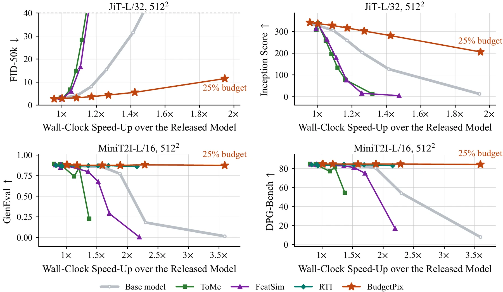
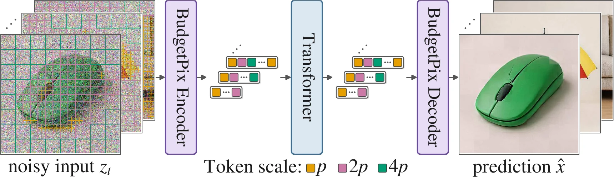

<h1 align="center">BudgetPix: Compute-Adaptive Tokenization for Pixel-Space Image Diffusion</h1>

<p align="center">
  <a href="https://karaozgur.com/">Ozgur Kara</a><sup>1,†</sup>,
  <a href="https://issaccyj.github.io/">Yujia Chen</a><sup>2</sup>,
  <a href="https://scholar.google.com/citations?user=ve9A9rMAAAAJ&hl=en">Daniel Watson</a><sup>2</sup>,
  <a href="https://scholar.google.com/citations?user=5H0arvkAAAAJ&hl=en">David Forsyth</a><sup>1</sup>,
  <a href="https://scholar.google.com/citations?user=8kA3eDwAAAAJ&hl=en">James Matthew Rehg</a><sup>1</sup>,
  <a href="https://scholar.google.com/citations?user=R-OrlSgAAAAJ&hl=en">Wen-Sheng Chu</a><sup>2,‡</sup>,
  <a href="https://dutran.github.io">Du Tran</a><sup>2,‡</sup>
</p>

<p align="center">
  <sup>1</sup>University of Illinois Urbana-Champaign &nbsp;&nbsp; <sup>2</sup>Google<br>
  <b>arXiv preprint, 2026</b><br>
  <sub><sup>†</sup>Work done during an internship at Google. &nbsp; <sup>‡</sup>Joint last authors.</sub>
</p>

<p align="center">
  <a href="https://arxiv.org/abs/2610.12307"></a>
  <a href="https://karaozgur.com/BudgetPix/"></a>
  <a href="https://karaozgur.com/BudgetPix/static/paper/BudgetPix.pdf"></a>
  <a href="https://huggingface.co/public-release-bp/BudgetPix"></a>
  <a href="LICENSE"></a>
</p>

<p align="center">
  <a href="https://karaozgur.com/BudgetPix/"></a>
</p>
<p align="center"><em>One checkpoint, any token budget: MiniT2I-L/16 at 512x512, same prompt and noise, across decreasing token budgets, with the token layout beside each image. The GIF is compressed; the full video is <a href="assets/teaser_720p.mp4">in this repository</a> and on the <a href="https://karaozgur.com/BudgetPix/">project page</a>.</em></p>

**TL;DR.** Pixel-space diffusion transformers spend the same compute on flat sky as on a face. BudgetPix lets one
model run at many compute budgets: an entropy quadtree merges flat regions of the image into coarser tokens, the
backbone runs on the shorter sequence, and a small token-local refiner puts the detail back inside each merged token.
Every added module is zero-initialised, so the adapted model starts as the released model and only has to learn to
survive shorter sequences. At inference a single checkpoint is driven with a token budget; the layout is recomputed
from the running estimate of the clean image as it forms.

<details>
<summary>Click for the full abstract</summary>

Most image generators use uniform tokenization, giving every equal-sized patch the same compute. This cannot adapt to
different resource limits at inference time, and it wastes effort on plain backgrounds that need less than detailed
regions. BudgetPix allocates compute based on visual complexity and spatial layout. It has three components: an
adaptive encoder that maps a fixed-size image to a variable-length token sequence, using an entropy-guided quadtree and
a multi-scale patch embedder; a scale-aware decoder that rebuilds a fixed-resolution image from multi-scale tokens; and
a training and sampling schedule that lets pixel-space denoisers handle variable token counts. It plugs into existing
pixel-space diffusion architectures, so one checkpoint can run at many compute budgets. In text-to-image generation it
matches MiniT2I-L at 512x512 (GenEval 0.874 vs. 0.882) and PixelDiT at 1024x1024 (GenEval 0.725 vs. 0.721) using about
25 % of the original compute; on class-conditional ImageNet with a MeanFlow backbone it uses about 60 % of full compute
with near-zero quality loss. Human and VLM judges report a better quality-efficiency trade-off than prior
budget-adaptive baselines.
</details>

### ❗ Public reimplementation

> **The original implementation is not public.** This repository applies the same adaptation recipe, with minimal
> changes, to four public pixel-space generators: [JiT](https://github.com/LTH14/JiT) (class-conditional ImageNet at
> 256 and 512), [MiniT2I](https://github.com/Hope7Happiness/minit2i-torch) (text-to-image at 512),
> [PixelDiT](https://github.com/NVlabs/PixelDiT) (text-to-image at 1024) and [pixel MeanFlow](https://github.com/Lyy-iiis/pMF)
> (one-step ImageNet at 256). **The checkpoints below were trained with this code. Their numbers are close to those
> reported in the paper but do not match them exactly.**

## 📰 Updates

- **[10/2026]** Code and eight checkpoints (JiT-B/L at 256 and 512, MiniT2I-B/L at 512, PixelDiT at 1024, pMF-L/16
  one-step at 256) released on 🤗 [Hugging Face](https://huggingface.co/public-release-bp/BudgetPix).

## 📈 Results

Headline numbers of the paper: in text-to-image generation BudgetPix matches MiniT2I-L at 512x512 (GenEval 0.874 vs.
0.882) and PixelDiT at 1024x1024 (GenEval 0.725 vs. 0.721) using about 25 % of the original compute; on class-conditional
ImageNet with the one-step MeanFlow backbone it needs about 60 % of the full compute for near-zero quality loss (FID
3.46 vs. 2.65). More results and the interactive comparisons are on the [project page](https://karaozgur.com/BudgetPix/).

<p align="center"></p>
<p align="center"><em>Quality against measured speed-up over the released model, JiT-L/32 and MiniT2I-L/16 at 512x512.</em></p>

### Image results

Image results for every model (MiniT2I, PixelDiT, JiT and one-step pMF, each run at a sweep of token budgets with the
token layout shown beside every sample) are on the **[project page](https://karaozgur.com/BudgetPix/)**, where the
budget can be set interactively.

## 📦 Model zoo

All checkpoints are on 🤗 [Hugging Face: public-release-bp/BudgetPix](https://huggingface.co/public-release-bp/BudgetPix).
Each holds the EMA weights of the full adapted model (backbone plus the added modules) in fp32, together with the
geometry and the trainer arguments it was trained with; nothing else is needed for inference besides the upstream
model code and, for text-to-image, the text encoder.

| checkpoint | base model | resolution | dense tokens | parameters | size | download |
|---|---|---|---|---|---|---|
| `jit_b16_256` | JiT-B/16 | 256 | 256 | 134 M | 0.53 GB | 🤗 [`budgetpix_jit_b16_256.pth`](https://huggingface.co/public-release-bp/BudgetPix/resolve/main/budgetpix_jit_b16_256.pth) |
| `jit_b32_512` | JiT-B/32 | 512 | 256 | 136 M | 0.54 GB | 🤗 [`budgetpix_jit_b32_512.pth`](https://huggingface.co/public-release-bp/BudgetPix/resolve/main/budgetpix_jit_b32_512.pth) |
| `jit_l16_256` | JiT-L/16 | 256 | 256 | 462 M | 1.85 GB | 🤗 [`budgetpix_jit_l16_256.pth`](https://huggingface.co/public-release-bp/BudgetPix/resolve/main/budgetpix_jit_l16_256.pth) |
| `jit_l32_512` | JiT-L/32 | 512 | 256 | 465 M | 1.86 GB | 🤗 [`budgetpix_jit_l32_512.pth`](https://huggingface.co/public-release-bp/BudgetPix/resolve/main/budgetpix_jit_l32_512.pth) |
| `minit2i_b_512` | MiniT2I-B/16 | 512 | 1024 | 260 M | 1.04 GB | 🤗 [`budgetpix_minit2i_b_512.pt`](https://huggingface.co/public-release-bp/BudgetPix/resolve/main/budgetpix_minit2i_b_512.pt) |
| `minit2i_l_512` | MiniT2I-L/16 | 512 | 1024 | 915 M | 3.66 GB | 🤗 [`budgetpix_minit2i_l_512.pt`](https://huggingface.co/public-release-bp/BudgetPix/resolve/main/budgetpix_minit2i_l_512.pt) |
| `pixeldit_1024` | PixelDiT-T2I 1.3B | 1024 | 4096 | 1307 M | 5.23 GB | 🤗 [`budgetpix_pixeldit_1024.pt`](https://huggingface.co/public-release-bp/BudgetPix/resolve/main/budgetpix_pixeldit_1024.pt) |
| `pmf_l16_256` | pMF-L/16 (one-step) | 256 | 256 | 517 M | 2.07 GB | 🤗 [`budgetpix_pmf_l16_256.pt`](https://huggingface.co/public-release-bp/BudgetPix/resolve/main/budgetpix_pmf_l16_256.pt) |

The download script fetches them from Hugging Face and checks every file against `checkpoints/SHA256SUMS`:

```bash
python scripts/download_checkpoints.py --all                       # the eight checkpoints
python scripts/download_checkpoints.py jit_l32_512 pmf_l16_256     # a selection
```

Two optional extras for the pMF line sit next to them (download keys `pmf_released_l16`, `pmf_released_b16`): 🤗 [`pmf_released_L16_full_uv.pt`](https://huggingface.co/public-release-bp/BudgetPix/resolve/main/pmf_released_L16_full_uv.pt)
and 🤗 [`pmf_released_B16_full_uv.pt`](https://huggingface.co/public-release-bp/BudgetPix/resolve/main/pmf_released_B16_full_uv.pt)
(the released pMF weights converted to torch with the auxiliary v-branch, which training needs; the no-training
control runs from the Hub's own `pMF-L-16.pt`).

The text encoders (`google/flan-t5-large` for MiniT2I, `Efficient-Large-Model/gemma-2-2b-it` for PixelDiT) are
downloaded from the Hugging Face Hub on first use. The released base models are needed only for training and for the
no-training control: JiT from https://github.com/LTH14/JiT, MiniT2I from https://huggingface.co/MiniT2I/MiniT2I,
PixelDiT from https://huggingface.co/nvidia/PixelDiT-1300M-1024px, pMF from https://huggingface.co/Lyy0725/pMF.

## ⚙️ Setup

Python 3.10+, PyTorch 2.4+ with CUDA (the released checkpoints were trained with torch 2.5 / CUDA 12.4); the code also
runs on CPU (slowly) for small samples.

```bash
git clone https://github.com/budgetpix/BudgetPix-public && cd BudgetPix-public
pip install -r requirements.txt
pip install flash-attn --no-build-isolation          # optional (CUDA): varlen attention kernels for the JiT lines; an exact SDPA fallback runs without it

git clone https://github.com/Hope7Happiness/minit2i-torch upstream/minit2i-torch && export MINIT2I_ROOT=$PWD/upstream/minit2i-torch   # MiniT2I lines
git clone https://github.com/NVlabs/PixelDiT upstream/PixelDiT && export PIXELDIT_ROOT=$PWD/upstream/PixelDiT                       # PixelDiT line
git clone -b torch https://github.com/Lyy-iiis/pMF upstream/pMF && export PMF_ROOT=$PWD/upstream/pMF                               # pMF line
```

The JiT backbone is vendored; the MiniT2I, PixelDiT and pMF model classes are imported at run time from those
checkouts (in `upstream/`, which git ignores) and are not modified.

## 🎨 Inference

Every sampler takes `--budget`, the number of tokens per image. The dense grid is 256 tokens for the JiT and pMF
lines, 1024 for MiniT2I and 4096 for PixelDiT; 50 % of the grid means half the tokens. Omit `--budget` for the dense grid.

```bash
# class-conditional ImageNet (JiT): ImageNet classes at 128 of 256 tokens, plus the token layout overlay
cd jit
python sample.py --ckpt ../checkpoints/budgetpix_jit_l32_512.pth --budget 128 --classes 207,88,417,933 --overlay
python sample.py --ckpt ../checkpoints/budgetpix_jit_b16_256.pth --sweep --classes 207,88    # 100 / 75 / 50 / 25 %, same noise
cd ..

# text-to-image at 512 (MiniT2I)
cd minit2i
python sample.py --ckpt ../checkpoints/budgetpix_minit2i_l_512.pt --prompts "a corgi in a spacesuit" --budget 512 --cfg 6.0
cd ..

# text-to-image at 1024 (PixelDiT)
cd pixeldit
python sample_apt.py --ckpt ../checkpoints/budgetpix_pixeldit_1024.pt --prompts "a red fox in a snowy forest" --budget 2048 --cfg 2.75 --out samples.png
cd ..

# one-step ImageNet (pMF): the layout is chosen up front, by default from the model's own dense sample of the same class and noise
cd pmf
python sample_pmf_apt.py --ckpt ../checkpoints/budgetpix_pmf_l16_256.pt --classes 207,88,417,933 --budget 128 --overlay --out samples.png
cd ..
```

The samplers' default guidance is 3.0 for JiT, 5.0 for MiniT2I, 2.75 for PixelDiT and 7.0 for pMF-L; the released
MiniT2I models recommend 6.0 for L and 2.5-5.0 for B at the dense grid. For the multi-step samplers the best value rises
as tokens fall: at 25 % of the grid it is about 6.0 for the 512-px JiT lines, 7.0 for MiniT2I and 4.5 for PixelDiT. See the per-family READMEs:
[`jit/`](jit/README.md), [`minit2i/`](minit2i/README.md), [`pixeldit/`](pixeldit/README.md), [`pmf/`](pmf/README.md).

<p align="center"></p>

## 🏋️ Training

Each line fine-tunes a released checkpoint with the recipe of the paper; the launchers and configs carry the exact
hyperparameters, and [`docs/TRAINING_DETAILS.md`](docs/TRAINING_DETAILS.md) lists every setting per scheme (data,
batch, learning rates, steps).

```bash
# JiT on ImageNet-1k (HuggingFace parquet shards); LINE = jit_b16_256 | jit_b32_512 | jit_l16_256 | jit_l32_512
cd jit
LINE=jit_l32_512 RELEASED=/weights/jit-l-32/checkpoint-last.pth DATA=/data/imagenet-1k/data NGPU=4 bash train.sh
cd ..

# MiniT2I on the 120K alignment mix (public Hub datasets; minit2i/mix120k_build.py writes the training chunks)
cd minit2i
torchrun --nproc_per_node=4 train.py --config configs/minit2i_l_512.yml --resume
cd ..

# PixelDiT on precomputed 1024-px chunks (pixeldit/precompute_data.py)
cd pixeldit
torchrun --nproc_per_node=4 train_apt.py --config configs/pixeldit_1024.yml --resume auto
cd ..

# pMF on ImageNet-1k, from the released weights with the auxiliary v-branch
cd pmf
DATA=/data/imagenet-1k/data WEIGHTS=../checkpoints/pmf_released_L16_full_uv.pt NGPU=7 bash scripts/train_l16.sh
cd ..
```

The JiT, MiniT2I and PixelDiT trainers check before the first step that training starts exactly from the released
model (all added modules are zero) and refuse to train otherwise. Training checkpoints are resumable, and the samplers read them directly
(EMA weights).

## 📊 Evaluation

Each line has an evaluation script that runs at a token budget: `jit/eval.py` (ImageNet FID / IS, 50k images),
`minit2i/eval.py` (FID / IS on held-out captions), `pixeldit/eval_apt.py` (held-out FID / IS and GFLOP per image) and
`pmf/eval_pmf_apt.py` (one-step FID / IS with pMF's protocol, including the ToMe and FeatSim baselines). The exact
commands are in the per-family READMEs.

## 📄 License

The code in this repository is released under the MIT License. The JiT backbone modules vendored in `jit/model.py`
come from the JiT release (MIT); the MiniT2I and pMF ports import the official PyTorch code of those projects (MIT).
PixelDiT and its released weights are distributed by NVIDIA under the NVIDIA License (NSCLv1), which permits
non-commercial use only; the BudgetPix PixelDiT checkpoint is a derivative of those weights and is released under the
same terms. The JiT, MiniT2I and pMF checkpoints are derivatives of MIT-licensed weights.

## 🙏 Acknowledgements

This reimplementation builds on [JiT](https://github.com/LTH14/JiT), [MiniT2I](https://github.com/Hope7Happiness/minit2i-torch),
[PixelDiT](https://github.com/NVlabs/PixelDiT) and [pixel MeanFlow](https://github.com/Lyy-iiis/pMF), whose released
models are the backbones of every line; the entropy-based layout rule follows [APT](https://github.com/rccchoudhury/apt);
FID and IS are computed with the [LTH14 fork of torch-fidelity](https://github.com/LTH14/torch-fidelity) and JiT's
reference statistics.

## 📚 Citation

```bibtex
@article{kara2026budgetpix,
  title={BudgetPix: Compute-Adaptive Tokenization for Pixel-Space Image Diffusion},
  author={Ozgur Kara and Yujia Chen and Daniel Watson and David Forsyth and James Matthew Rehg and Wen-Sheng Chu and Du Tran},
  journal={arXiv preprint arXiv:2610.12307},
  year={2026}
}
```
